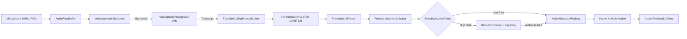

# Voice — Offline AI Mobile Assistant

> **Private. Responsive. Offline.**  
> An actions-first native Android voice assistant powered by Google's **FunctionGemma 270M Mobile Actions** and **LiteRT-LM**.

---

## Overview

**Voice** is an on-device, actions-first mobile agent for Android. Unlike conversational chatbots that require cloud infrastructure, Voice processes speech, understands intent, validates tool schemas, and executes native Android commands **100% locally on your phone**.

- **Zero Cloud Latency & Zero Telemetry**: The `offline` flavor does not include `android.permission.INTERNET`. Your voice never leaves your device.
- **FunctionGemma 270M**: Uses Google's fine-tuned FunctionGemma model to perform deterministic function calling across 13 native mobile tools.
- **Hardware-Backed Biometrics**: High-risk actions (SMS, messaging replies, device lock) are protected by Android Keystore EC P-256 signatures and `BiometricPrompt` (`BIOMETRIC_STRONG`).
- **Android 14/15/16 Compliant**: Strict `FOREGROUND_SERVICE_MICROPHONE` lifecycle management with persistent notifications, interactive controls, and zero illegal background activity launches.

---

## Architecture



For an in-depth breakdown of the audio pipeline, inference grammar, and native execution layers, see [ARCHITECTURE.md](docs/ARCHITECTURE.md).

---

## Supported Voice Actions

Voice supports 13 native mobile actions with strict parameter schema validation:

| Category | Example Voice Commands | Function Call | Risk Tier |
| :--- | :--- | :--- | :--- |
| **System** | _"Turn on flashlight"_, _"Torch on karo"_ | `turn_flashlight_on{}` | LOW |
| **System** | _"Turn off flashlight"_, _"Torch light band karo"_ | `turn_flashlight_off{}` | LOW |
| **System** | _"Lock the screen"_, _"Lock device"_ | `lock_screen{}` | HIGH (Biometrics) |
| **Telephony**| _"Call Rahul"_, _"Papa ko call lagao"_ | `make_call{contact_name}` | MEDIUM |
| **Telephony**| _"Answer call"_, _"Reject call"_ | `answer_call{}`, `reject_call{}` | MEDIUM |
| **Messaging**| _"Send SMS to Mom saying I will be late"_ | `text_msg{contact_name, body}` | HIGH (Biometrics) |
| **Messaging**| _"Reply to Alice saying On my way"_ | `reply_to_notification{id, body}` | HIGH (Biometrics) |
| **Camera** | _"Take a selfie"_, _"Photo kheecho"_ | `open_camera{}` | LOW |
| **Alarms** | _"Set alarm for 7 AM"_, _"Alarm lagao 8:30"_ | `set_alarm{hour, minute, label}` | MEDIUM |
| **Notes** | _"Take a note buy groceries"_ | `take_notes{content}` (AES Encrypted) | LOW |
| **Apps** | _"Open WhatsApp"_, _"Launch Camera"_ | `open_app{package_name}` | LOW |

---

## Quickstart & Build Instructions

### Prerequisites
1. **Android Studio** (Ladybug / Jellyfish or newer)
2. **JDK 17**
3. **Android SDK Platform 36** (API 36)
4. A physical Android device running **Android 11 (API 30) or higher** (Android 14+ recommended).

### 1. Clone the Repository
```bash
git clone https://github.com/rcpspk0305-bit/Mobile-Voice-Agent.git
cd Mobile-Voice-Agent/VoiceOffline
```

### 2. Configure Local Properties
Create `VoiceOffline/local.properties`:
```properties
sdk.dir=C\:\\Users\\<YourUsername>\\AppData\\Local\\Android\\Sdk
```

### 3. Build & Run Tests
```powershell
# Windows PowerShell
$env:JAVA_HOME = "C:\Program Files\Java\jdk-17"
.\gradlew.bat testOfflineDebugUnitTest
```
To assemble the offline debug APK:
```powershell
.\gradlew.bat assembleOfflineDebug
```

---

## Model Setup & Installation

Voice requires two lightweight on-device models:
1. **Vosk Speech Recognition Model**: Download `vosk-model-small-en-us-0.15.zip` from [Vosk Models](https://alphacephei.com/vosk/models) and extract into `app/src/main/assets/vosk-model/`.
2. **FunctionGemma 270M Model**: Download `functiongemma-270m-mobile-actions.bin` from [Hugging Face (`litert-community/functiongemma-270m-ft-mobile-actions`)](https://huggingface.co/litert-community/functiongemma-270m-ft-mobile-actions) and push to `/sdcard/Android/data/dev.voice.offline/files/models/`.

Detailed step-by-step instructions with SHA-256 verification and ADB commands are available in [MODEL_SETUP.md](docs/MODEL_SETUP.md).

---

## Security & Privacy Assurance

- **Zero Network Traffic**: The `offline` flavor does not declare or request `android.permission.INTERNET`.
- **Encrypted Local Storage**: Notes created via voice commands are encrypted using AES-256-GCM backed by hardware Keystore keys.
- **Replay Protection**: High-risk commands expire automatically after 30 seconds (`PendingCommandStore`).
- **Prompt Injection Defense**: 100% defense against adversarial prompt injections verified by automated evaluation tests (0.00% False Positive Rate).

Read the complete security specification in [SECURITY.md](docs/SECURITY.md).

---

## Documentation Index

- [ARCHITECTURE.md](docs/ARCHITECTURE.md) — Comprehensive technical architecture and pipeline design.
- [MODEL_SETUP.md](docs/MODEL_SETUP.md) — FunctionGemma 270M and Vosk model download and setup guide.
- [SECURITY.md](docs/SECURITY.md) — Threat model, Keystore signing, and prompt injection defenses.
- [PERMISSIONS.md](docs/PERMISSIONS.md) — Exhaustive permissions audit and Android 14/15/16 compliance.
- [TESTING.md](docs/TESTING.md) — Test strategy and 57-case linguistic evaluation report.
- [PERFORMANCE.md](docs/PERFORMANCE.md) — Latency budget (<1500ms), RAM budget (<350MB), and device tiers.
- [RELEASE_CHECKLIST.md](docs/RELEASE_CHECKLIST.md) — Pre-flight distribution and policy checklist.

---

## License

This project is licensed under the Apache 2.0 License. See [LICENSE](LICENSE) for details.
